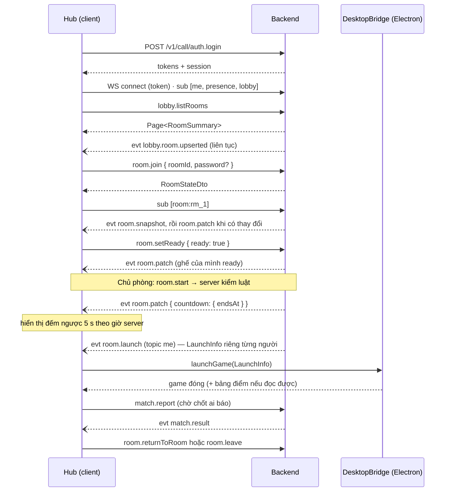

# Contract hub ⇄ backend (v0 — nháp)

Hợp đồng dữ liệu giữa ứng dụng hub (React, chạy trong Electron) và máy chủ. Mục tiêu: backend làm song song theo đúng bản mô tả này; màn hình chỉ gọi qua interface `HubClient`, hôm nay chạy bằng mock, sau đổi sang server thật mà không sửa màn.

**Trạng thái (14/11):** nháp v0, `CONTRACT_VERSION = "0.1.0"`. Được đổi phá vỡ cho tới v1. Các màn T2–T7, T9–T11 còn đang dựng nên phần tương ứng còn đổi. Những điểm chưa chốt: [§6](#6-còn-mở).

## 1. Đọc theo thứ tự

1. [conventions.md](conventions.md) — id, thời gian, lỗi, phân trang, HTTP kiểu RPC, khung WebSocket, nối lại, phiên bản.
2. [api-index.md](api-index.md) — **26 truy vấn · 69 lệnh · 33 sự kiện**, sinh tự động từ code (`python -I tools/build_contract_docs.py`).
3. [`contract/`](../../contract/) — nguồn sự thật, TypeScript thuần, không phụ thuộc gì ngoài chính nó.
4. [rules.md](rules.md) — luật nghiệp vụ server phải tự kiểm + mã lỗi.
5. [inventory.md](inventory.md) — màn nào cần dữ liệu gì; trường nào là UI-only; điểm mơ hồ.

## 2. Bản đồ `contract/`

| File | Nội dung |
|---|---|
| [`common.ts`](../../contract/common.ts) | Id, `IsoDateTime`, `Page`, `ImageRef`, enum game (`Faction`, `CivId`, `MapType`, `GameType`, `RankTier`…), `PlayerSummary`, `SystemText` |
| [`limits.ts`](../../contract/limits.ts) | Giới hạn ô nhập, luật phòng / giải / clan dạng hằng số |
| [`errors.ts`](../../contract/errors.ts) | `ErrorCode`, `ApiError` |
| [`auth.ts`](../../contract/auth.ts) | Đăng nhập, đăng ký, token, phiên, vai (`moderator` = QTV) |
| [`chat.ts`](../../contract/chat.ts) | Kênh (sảnh / phòng / giải / clan / tin riêng), tin nhắn, lịch sử |
| [`social.ts`](../../contract/social.ts) | Bạn bè, lời mời, chặn, presence |
| [`lobby.ts`](../../contract/lobby.ts) | Danh sách phòng, lọc, tìm theo mã |
| [`room.ts`](../../contract/room.ts) | Trạng thái phòng (snapshot + patch), ghế, cài đặt, đếm ngược, `LaunchInfo` |
| [`match.ts`](../../contract/match.ts) | Kết quả trận, dòng lịch sử, báo kết quả |
| [`tournament.ts`](../../contract/tournament.ts) | Giải, đội, nhánh đấu, kết quả trận giải |
| [`clan.ts`](../../contract/clan.ts) | Clan, thành viên, vai, đơn, lời mời, thông báo, hoạt động |
| [`player.ts`](../../contract/player.ts) | Hồ sơ, thống kê, thành tựu, kho đồ, danh mục tĩnh |
| [`home.ts`](../../contract/home.ts) | Banner, changelog, `system.health`, thông báo hệ thống |
| [`api.ts`](../../contract/api.ts) | Bảng gộp `Queries` / `Commands` / `Events`, chủ đề, **interface `HubClient`** |
| [`transport.ts`](../../contract/transport.ts) | Khung tin WebSocket, mã đóng kết nối |
| [`fixtures/`](../../contract/fixtures/index.ts) | Dữ liệu mẫu cho mọi DTO chính + khung tin; `npm run typecheck` bắt fixture lệch kiểu |

Kiểm tra enum contract trùng enum UI đang dùng: [`demo/app/api/compat.ts`](../../demo/app/api/compat.ts) (15 enum; lệch → typecheck lỗi).

## 3. Cách gọi (tóm tắt)

```ts
const client: HubClient = useHub();                      // context của C6 (chưa làm): MockHubClient hoặc HttpHubClient
const { roomId } = await client.call("room.create", { name: "Giao hữu", category: "random" });
const release = client.subscribe([`room:${roomId}`]);    // nhận room.snapshot rồi room.patch
const off = client.on("room.patch", (patch) => apply(patch));
await client.call("room.setReady", { roomId, ready: true });
```

- HTTP: `POST <apiBase>/v1/call/<tên>`, thân = payload. WebSocket: `{ "t": "cmd", "id", "name", "payload" }` → `{ "t": "ack", "id", "result" | "error" }`.
- Kết quả của lệnh chỉ dùng cho người bấm (ví dụ `roomId` để chuyển màn); trạng thái chung luôn cập nhật theo **sự kiện**.

## 4. Luồng chính



Nối lại khi rớt mạng: client gửi `sub` kèm `since` (seq cuối mỗi chủ đề) → server gửi bù hoặc gửi lại snapshot. Chi tiết: [conventions.md §6](conventions.md#6-websocket).

## 5. Nhật ký thay đổi

| Phiên bản | Ngày | Thay đổi |
|---|---|---|
| 0.1.0 | 14/11/2026 | Nháp đầu: 10 module, quy ước, luật server, fixture, bảng tự sinh. Dựa trên mock T1–T11 hiện có. |

## 6. Còn mở

Chờ người dùng / đội backend chốt (cũng ghi ở PLAN.md "Quyết định còn mở" và [inventory.md §4](inventory.md#4-mơ-hồ--cần-người-dùng--backend-chốt)):

- Backend viết bằng gì → dùng chung `contract/` (TypeScript) hay xuất JSON Schema / OpenAPI.
- Có cần kiểm tra dữ liệu lúc chạy (zod) không.
- Đăng nhập: tài khoản riêng hay bên thứ ba; mật khẩu tối thiểu 6 hay 8.
- Ai báo kết quả trận (`match.report`) — chống gian lận.
- Elo / bậc hạng / mùa.
- QTV là vai toàn hệ thống hay theo giải.
- Phòng có Màu / Đội / AI / tốc độ / thời đại không (wireframe có, màn đã dựng không có).
- Chủ phòng rời: chuyển chủ hay đóng phòng; phòng clan có chặn người ngoài không.
- `LaunchInfo.relay` phụ thuộc cách relay / TURN hoạt động — cần đội làm relay mô tả.

## 7. Ngoài phạm vi contract này

- **`DesktopBridge`** (bước 5): đường dẫn game, mở game, theo dõi tiến trình, cài đặt máy (T8), lưu token. Đi qua preload của Electron, không qua backend.
- Voice chat và TURN: kênh media riêng, mô tả sau khi chốt kiến trúc relay.
